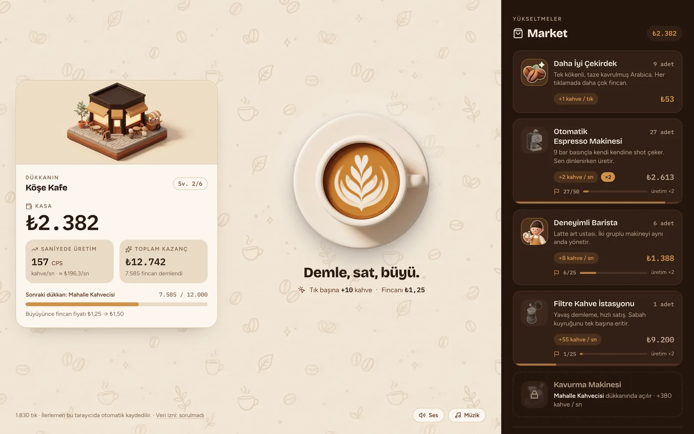
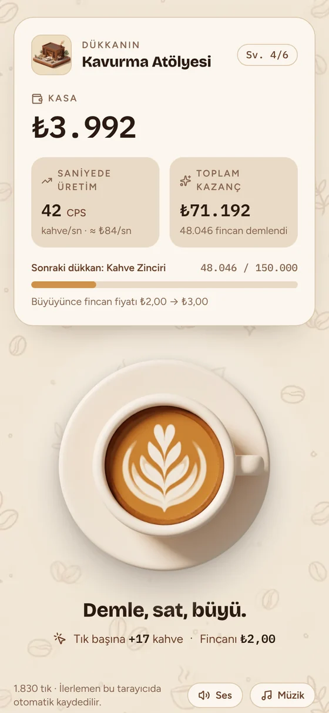
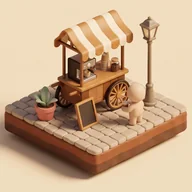
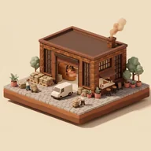
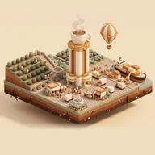
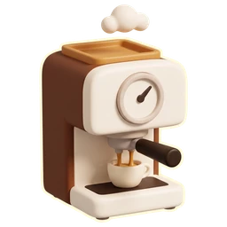
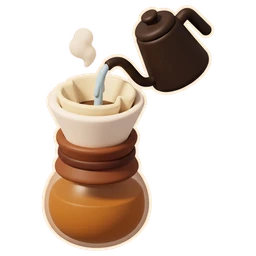
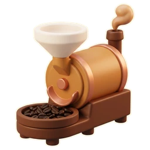
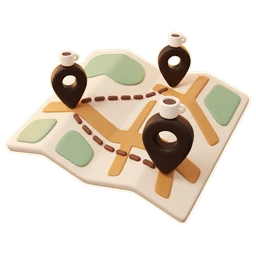

# Barista Clicker 2.0

Kahve demle, sat, dükkânını seyyar tezgâhtan kahve imparatorluğuna büyüt. React ile yazılmış, tarayıcıda ve Android'de çalışan bir clicker oyunu.

**[Tarayıcıda oyna](https://efeertureten.github.io/barista-clicker-2.0-sifir/)** · **[Android için indir (APK)](https://github.com/efeertureten/barista-clicker-2.0-sifir/releases/latest/download/barista-clicker.apk)**

<p>
  
  
</p>

## Nasıl oynanır

Yeni oyuncuyu bir rehber karşılar ve ilk dakikada döngünün dört parçasından geçirir: latteye dokun, ilk yükseltmeyi al, ilk üreticiyi al (oyuncu yokken de kazanmanın ön koşulu), Köşe Kafe'ye ulaş. Rehber oyunun durumuna bakarak ilerler; sayfa yenilense de, adımlar farklı sırayla yapılsa da doğru yerden devam eder ve istenirse geçilebilir. Geniş ekranda fincanın altında, telefonda ekranın altında durur.

- Latteye tıkla, her tıklama kahve demler ve kasaya para koyar.
- Marketten yükseltme al: tık başına daha çok kahve ya da sen tıklamazken çalışan otomatik üretim.
- Toplam demlenen fincan sayısı arttıkça dükkânın büyür, büyüdükçe fincan başına satış fiyatı da artar ve markette yeni bir üretici açılır.
- Bir üreticiden 25, 50, 100, 150, 200 ve 300 adete ulaştığında o üreticinin üretimi her seferinde 2 katına çıkar.
- Kahve İmparatorluğu'na ulaşınca **Yeni Şube** açabilirsin: başka bir semtte (Kadıköy, Balat, Beşiktaş…) seyyar tezgâhla yeniden başlarsın ama itibar kazanırsın. İtibar = küp kök(bu şubede demlenen fincan / 800 milyon); her puan üretimi ve tık gücünü %10 artırır. Kasa, fincanlar, yükseltmeler ve dükkân seviyesi sıfırlanır; itibar, toplam kazanç ve tık sayısı kalır. Şubeyi ne kadar geç açarsan o kadar çok itibar kazanırsın.
- Her gün 3 **sipariş** gelir ("250 kez latteye dokun", "X fincan demle", "8 yükseltme al", "Hoş geldin kartından topla"); hedefler o anki gücüne göre ölçeklenir. Her teslim para ve 1 **Altın Çekirdek** verir, üçü birden +2 daha. Sipariş teslim ettiğin her gün **seriye** eklenir; kaçırdığın günü dondurma hakkı karşılar (2 hak, her 7 günde biri geri gelir), 3, 7, 14 ve 30. günlerde ek Altın Çekirdek var. Altın Çekirdeği **hızlı demlemeye** harcarsın: 5 Altın Çekirdeğe 1 saatlik üretim. Siparişler gece yarısı yenilenir; geri sayım yok.
- Sen yokken de dükkân yarım hızla çalışır. Kazanç en çok 4 saat birikir; döndüğünde "Hoş geldin" kartından kasaya toplarsın. Bir dakikadan kısa ayrılıklar sayılmaz, üretim tam hızla devam eder.
- İlerleme tarayıcıda otomatik kaydedilir.

## Dükkân seviyeleri

| | Sv. | Dükkân | Açıldığı an (toplam fincan) | Fincan fiyatı |
|---|---|---|---|---|
|  | 1 | Seyyar Tezgâh | başlangıç | ₺1,00 |
|  | 2 | Köşe Kafe | 300 | ₺1,25 |
|  | 3 | Mahalle Kahvecisi | 12.000 | ₺1,50 |
|  | 4 | Kavurma Atölyesi | 400.000 | ₺2,00 |
|  | 5 | Kahve Zinciri | 15 milyon | ₺3,00 |
|  | 6 | Kahve İmparatorluğu | 100 milyar | ₺5,00 |

Ulaşılan seviye kayda yazılır ve hiç düşmez. 2.1'den önce oynamaya başlayan oyuncular, eski (daha düşük) eşiklerle kazandıkları dükkânı korur.

## Yükseltmeler

Her alımda fiyat %15 artar. Bütün bu değerler `src/game/config.js` dosyasında.

| | Yükseltme | Etki | Başlangıç fiyatı | Açıldığı dükkân |
|---|---|---|---|---|
|  | Daha İyi Çekirdek | +1 kahve / tık | ₺15 | Sv.1 |
|  | Otomatik Espresso Makinesi | +1 kahve / sn | ₺60 | Sv.1 |
|  | Deneyimli Barista | +8 kahve / sn | ₺600 | Sv.1 |
|  | Filtre Kahve İstasyonu | +55 kahve / sn | ₺8.000 | Sv.2 |
|  | Kavurma Makinesi | +380 kahve / sn | ₺110.000 | Sv.3 |
|  | Kahve Kamyoneti | +2.600 kahve / sn | ₺1,6 milyon | Sv.4 |
|  | Bayi Ağı | +18.000 kahve / sn | ₺24 milyon | Sv.5 |
|  | Kahve Plantasyonu | +130.000 kahve / sn | ₺400 milyon | Sv.6 |

Markette açılmış yükseltmelerin yanında bir sonraki dükkânda açılacak üretici kilitli olarak görünür. Üretici kartlarında sonraki kilometre taşına ilerleme ve geçerli çarpan (×2, ×4…) yazar.

Bu denge, günde 4 kısa oturum oynayan bir oyuncu için simülasyonla ayarlandı: Sv.5 ilk gün, Kahve İmparatorluğu 5. gün.

## 2.0'da neler yeni

- İkonların yerini kil görünümlü 3D görseller aldı: tıklanan latte, yükseltme ikonları ve her seviye için ayrı bir izometrik dükkân sahnesi.
- Dükkân kartının üstünde o anki dükkânın sahnesi duruyor; seviye atlayınca yumuşak geçişle değişiyor, sıradaki sahne önceden yükleniyor.
- Her tıklamada fincandan kahve çekirdekleri fırlıyor.
- "Dükkân büyüdü" bildiriminde yeni dükkânın küçük resmi var.
- Alınamayan yükseltmeler gri görünüyor, alınabilir hale gelince zıplıyor.
- Arka planda kahve çizimli bir doku var; geniş ekranda kart ile fincan yan yana diziliyor.
- Sesler: fincana her dokunuşta baloncuk patlaması ve kısa bir marimba ezgisi, her yükseltmenin kendi satın alma sesi, dükkân büyüyünce kapı zili ve kutlama melodisi, son seviyede fanfar, bir yükseltme alınabilir hale gelince ince belli bardak "ting"i.
- Arka plan müziği: ilk açılışta girişiyle başlar, sonra kesintisiz döngüye girer; dükkân büyürken kutlama duyulsun diye kısılır, sekme arka plandayken durur.
- Alttaki **Ses** ve **Müzik** düğmeleriyle ikisi ayrı ayrı kapatılabiliyor, tercih hatırlanıyor.
- Hareket azaltma (`prefers-reduced-motion`) açıkken animasyonlar kapanıyor.

## Yerelde çalıştırma

Node.js 18 veya üstü gerekir.

```bash
npm install
npm run dev      # geliştirme sunucusu
npm run build    # dist/ klasörüne üretim derlemesi
npm run preview  # derlemeyi yerelde aç
```

`main` dalına her push'ta `.github/workflows/deploy.yml` siteyi derleyip GitHub Pages'a yayınlar, `.github/workflows/android.yml` Android paketini derler.

## Android uygulaması

Oyun aynı kodla [Capacitor](https://capacitorjs.com) üzerinden Android uygulaması olarak da paketlenir (`android/` klasörü). Uygulama kimliği `io.github.efeertureten.baristaclicker`. En düşük Android 7 (API 24), hedef Android 16 (API 36); Google Play 31 Ağustos 2026'dan beri yeni uygulamalarda ve güncellemelerde bu hedefi istiyor.

- Oyun dosyaları uygulamanın içinde, yazı tipleri dahil. İnternet olmadan da açılır ve oynanır; yalnızca ölçüm (izin verildiyse) internet ister.
- Geri tuşu açık pencereyi kapatır (Hoş geldin kartı toplanır, Yeni Şube ve sıfırlama onayı iptal edilir). Kapatacak bir şey yoksa uygulama arka plana alınır, kapanmaz.
- Uygulama arka plana geçince oyun, tarayıcıda sekme gizlenmiş gibi davranır: üretim çevrimdışı kurallarıyla birikir, müzik durur, oyun kaydedilir. Bunun için `src/platform/native.js` tarayıcının `visibilitychange` olayını Android'in ön plan/arka plan olayıyla birleştirir.
- Ekran dikey. Çentik ve hareket çubuğu için boşluklar `env(safe-area-inset-*)` ile verilir; sistem çubukları saydam, simgeleri koyu.
- Kayıt telefonda saklanır; tarayıcıdaki ilerleme uygulamaya geçmez. Android'in otomatik yedeklemesi açık.
- Ölçümde `platform` oyuncu özelliği `android` olur (tarayıcıda `web`).

**Derleme.** `main`'e her push'ta GitHub Actions paketi derler ve çalıştırmanın "Artifacts" bölümüne koyar. Sürüm `package.json`'dan gelir (`2.5.0` → versionCode `20500`). `src/game/config.js` içindeki `APP_VERSION` ile aynı olmalı, değilse derleme durur. Play her yüklemede daha büyük bir versionCode istediği için her mağaza sürümünde sürüm numarası artırılır.

**İmza.** Play'e yüklenen paket (AAB) ve arkadaşlara dağıtılan APK yükleme anahtarıyla imzalanır. Anahtar depoda değil, iki depo sırrında durur (Settings → Secrets and variables → Actions):

| Sır | İçerik |
|---|---|
| `ANDROID_KEYSTORE_BASE64` | anahtar dosyasının (`.jks`) base64 hâli |
| `ANDROID_KEYSTORE_PASSWORD` | anahtarın şifresi (takma ad `upload`) |

Sırlar yoksa yalnızca ayrı bir deneme uygulaması üretilir ("Barista Deneme", `…baristaclicker.deneme`); asıl uygulamayla çakışmaz.

**Arkadaşlara dağıtım.** İmza sırları tanımlıysa, `main`'deki sürüm (`package.json`) henüz yayınlanmamışsa derleme imzalı APK'yı `v<sürüm>` adıyla GitHub sürümü olarak yayınlar. Yani sürüm numarasını artırıp `main`'e göndermek yeni bir sürüm çıkarmak demek. [Şu bağlantı](https://github.com/efeertureten/barista-clicker-2.0-sifir/releases/latest/download/barista-clicker.apk) hep en son sürümü indirir. Aynı anahtarla imzalandığı için yeni sürüm eskisinin üstüne kurulur, ilerleme silinmez. Sırları ilk kez ekledikten sonra Actions → "Android paketi" → "Run workflow" ile o anki sürüm yayınlanır.

**Simgeler.** `python3 tools/android/make_icons.py`, uyarlanabilir simgeyi ve eski cihazların açılış ekranını `public/icon-512.png`'den yeniden üretir. Android 12 ve sonrasında açılışta köpük renginde zeminde uygulama simgesi görünür.

**Yerelde.** Android Studio kuruluysa: `npm run android` (derler, Android projesine kopyalar ve Android Studio'da açar).

## Proje yapısı

```
src/
  BaristaClicker.jsx     arayüz ve oyun döngüsü; aşağıdaki modülleri birbirine bağlar
  game/
    config.js            ayarlanabilir bütün denge değerleri ve Remote Config doğrulaması (mergeConfig)
    activeConfig.js      bu oturumun dengesi: varsayılan + Remote Config'ten en son gelen
    content.js           yükseltme ve dükkân adları, açıklamaları, görselleri; şube semtleri
    economy.js           saf oyun mantığı: tık, üretim, satın alma, seviye, kilometre taşları, Yeni Şube
    save.js              oyun kaydını okuma, doğrulama, eski kayıtları taşıma ve yazma
    meta.js              kurulum tarihi, oturum sayısı, oyun süresi, ilk deneyim adımları, rehber grubu
    tutorial.js          rehberin adımları (oyun durumundan türetilir) ve A/B grubu ataması
    orders.js            günlük siparişler, seri ve dondurma hakları
    format.js            sayı ve para biçimleri
  audio/
    soundEngine.js       Web Audio ses motoru (efekt ve müzik kanalları, müzik kısma)
    sounds.js            ses dosyalarının listesi ve müzik döngü noktaları
  analytics/
    analytics.js         ölçüm katmanı: izin, olay sırası, Firebase ve hata ayıklama çıkışı
    remoteConfig.js      Remote Config'ten "economy" parametresini indirir ve saklar
    firebaseConfig.js    Firebase yapılandırması (boşken hiçbir yere veri gitmez)
  platform/
    native.js            tarayıcı mı Android mi; görünürlük (ön plan / arka plan) ve geri tuşu
  cloud/
    firebaseRest.js      anonim giriş ve Firestore belgeleri (REST, SDK'sız)
    cloudSave.js         bulut kaydı: kayıt kodu, yedekleme, geri yükleme, çakışma
    feedback.js          oyun içi geri bildirim
  ui/                    stiller, market kartları ve kısayolu, rehber, günün siparişleri, Yeni Şube paneli ve onayı, ses düğmesi, veri izni bandı, Hoş geldin kartı
  lib/                   localStorage ve dosya yolu yardımcıları
  barista-assets/        oyun görselleri (WebP)
  barista-sounds/        oyun sesleri (MP3)
  main.jsx, index.css    giriş noktası ve Tailwind
tools/sentetik-beta/     gerçek oyun kodunu oynayan sentetik oyuncu simülatörü ve analizi
tools/android/           simge üretici ve sürüm kontrolü
android/                 Capacitor Android projesi (oyun dosyaları derlemede içine kopyalanır)
capacitor.config.json    uygulama kimliği, adı, sistem çubukları
firestore.rules          Firestore güvenlik kuralları (Firebase konsoluna yapıştırılır)
public/                  favicon, uygulama ikonları ve gizlilik sayfası
docs/                    README ekran görüntüleri
```

Oyun dengesini değiştirmek için yalnızca `src/game/config.js` dosyasına dokunmak yeter; `BaristaClicker` bileşeni farklı bir yapılandırmayı `config` özelliğiyle de alabilir. Bu, ileride değerleri Firebase Remote Config'ten çekip A/B testi yapmanın temeli.

## Bulut kaydı ve geri bildirim

Oyuncu isterse ilerlemesini bulutta yedekler. Alttaki **Bulut kaydı** bağlantısı bir pencere açar: "Bulut kaydını aç" 12 karakterlik bir kayıt kodu üretir (ör. `VB7Y-Q46Q-J7ZB`). Başka bir cihazda (tarayıcı, Android, ileride Play sürümü) "Kodum var" deyip bu kodu yazan kaldığı yerden devam eder.

- **Yedekleme:** Kayıt Firestore'da `saves/<kod>` belgesinde durur. Oyun her 3 dakikada bir (ilerleme anlamlı ölçüde değiştiyse) ve arka plana geçerken yedekler.
- **Erişim:** Kod hesap yerine geçer. Kurallar listelemeyi yasakladığı için kodlar tahmin edilemez (30¹² ≈ 5×10¹⁷ olasılık). Her istek bir Firebase anonim girişiyle yapılır.
- **Çakışma:** Her yazma, son bilinen sürüme (`updateTime`) bağlıdır. İki cihaz da oynadıysa oyun hangi kaydın kalacağını sorar; hiçbir ilerleme sessizce ezilmez.
- **Kapatma:** Bulut kaydı kapatılınca buluttaki kopya silinir.
- **Veri izninden bağımsız:** Bulut kaydı yalnızca oyuncu açarsa çalışır. Açılmadıkça Firebase'e tek istek gitmez.

**Geri bildirim** bağlantısı küçük bir form açar (Hata / Fikir / Diğer). Mesaj; sürüm, platform ve dükkân seviyesiyle birlikte Firestore'daki `feedback` koleksiyonuna eklenir. Mesajlar Firebase konsolunda, Firestore Database → `feedback` altında okunur; oyuncular birbirininkini göremez.

İkisi de Firebase SDK yerine REST ile çalışır (`src/cloud/`), böylece paket küçük kalır.

**Firebase kurulumu (bir kez):**
1. Authentication → Get started → Sign-in method → **Anonymous**'u aç.
2. Firestore Database → Create database. Konum olarak Avrupa'dan birini seç (sonradan değişmez), "production mode" ile başlat.
3. Firestore Database → Rules: depodaki [`firestore.rules`](firestore.rules) dosyasının tamamını yapıştır → **Publish**.

## Dengeyi uzaktan değiştirmek (Remote Config)

Oyunun bütün sayıları Firebase Remote Config'teki tek bir **`economy`** parametresiyle, yeni sürüm yayınlamadan değiştirilebilir. Bu, A/B testlerinin temeli.

1. Firebase konsolunda **Remote Config → Parametre oluştur**.
2. Parametre adı `economy`, veri türü **JSON**.
3. Değere yalnızca değişecek alanları yaz. Örneğin depo sınırını 4 saate çıkarıp makineyi güçlendirmek için:

```json
{
  "version": "depo-4sa",
  "offline": { "capSeconds": 14400 },
  "upgrades": { "machine": { "cps": 2 } }
}
```

- Alanların tamamı ve anlamları `src/game/config.js` içindeki `DEFAULT_CONFIG`'te. `version` her değişiklikte farklı bir ad olsun; ölçümde `economy_version` olarak görünür.
- Her alan tek tek doğrulanır; geçersiz bir değer (örn. `"costGrowth": 5`) atlanır, gerisi uygulanır ve `config_rejected` olayı gönderilir. Oyun asla bozuk bir dengeyle açılmaz.
- Değerler oyun sırasında indirilir ama **bir sonraki açılışta** uygulanır; fiyatlar oyuncunun gözü önünde değişmez. Aynı tarayıcı en fazla saatte bir sorar (`?debug=1` ile her açılışta).
- Remote Config de yalnızca veri iznini veren oyuncularda çalışır; diğerleri varsayılan dengeyle oynar.
- Parametreyi silmek her şeyi varsayılana döndürür.

## Sentetik beta

`tools/sentetik-beta` klasöründeki simülatör, oyunun gerçek kodunu oynayan sentetik oyuncularla 14 günlük bir beta üretir ve Firebase'e gidecek olayların aynısını yazar (ayrıntılar klasörün README'sinde). İlk çalıştırmadan çıkan kararlar:

- **Telefonda market kısayolu:** rehbersiz telefon oyuncularının yarısı marketi ilk oturumda bulamıyordu. Telefonda ve tablette sağ altta sabit bir düğme markete götürür (alınabilir yükseltme sayısıyla), marketteyken latteye döndürür.
- **Çevrimdışı depo 4 saat:** 2 saatlik depo dönüşlerin %61'inde doluydu; 4 saat hiçbir varsayımda 2 saatin gerisinde kalmadı.
- **Rehber herkeste:** market kısayoluyla rehberin ek etkisi küçüldü, A/B testi için gereken örneklem çok büyüdü. Grup ataması kodda duruyor: `tutorial.share` değeri (`1` herkes, `0.5` yarı yarıya) ile yeniden açılabilir; grup kurulumda cihazda atanır ve `tutorial_variant` özelliğiyle ölçüme gider. Bu oran Remote Config'ten değil koddan değişir, çünkü web'de veri izni ilk tıktan sonra sorulduğu için Remote Config yeni oyuncuya ilk açılışta ulaşamaz.
- **Günlük siparişler (2.4):** önce sentetik betada sınandı. İlk ayar fazla kolaydı (gündelik oyuncuların %98'i her gün üçünü bitiriyordu) ve ilerlemeyi %23 hızlandırıyordu; hedefler yükseltilip ödüller azaltıldı. Seçilen ayarda gündelik oyuncuların %93'ü, bir kez deneyenlerin %65'i günü tamamlıyor; D7'ye katkı varsayıma göre +1,1 ile +4,0 puan arası.
- **Yeni Şube (2.3):** içerik bağlı oyuncular için 3. günde bitiyordu; Yeni Şube ile sentetik oyuncularda D14 tutulması %4,4'ten %8,4'e çıkıyor (4 saatlik depoyla birlikte).

## Ölçüm

Oyun, hangi oyuncuların geri döndüğünü ve nerede takıldığını görmek için oynanış olaylarını Google Analytics for Firebase'e (proje `barista-7c17e`) gönderir; ama yalnızca oyuncu izin verirse.

- Oyuncuya ilk tıklamadan sonra köşede bir izin bandı çıkar. "Kabul et" demeden hiçbir olay gönderilmez; o ana kadar biriken olaylar kabul edilirse gönderilir, reddedilirse silinir. Karar, alttaki "Veri izni" bağlantısından her zaman değiştirilebilir; izin geri çekilince Google Analytics çerezleri de silinir.
- Firebase kütüphanesi ayrı bir parça olarak yalnızca izin verildiğinde indirilir; izin vermeyen oyuncunun tarayıcısı Google'a hiç istek göndermez.
- Ad, e-posta gibi bilgiler toplanmaz. Oyunculara yönelik açıklama [`public/gizlilik.html`](public/gizlilik.html) sayfasında, izin bandından bağlantı var.
- `src/analytics/firebaseConfig.js` içindeki yapılandırma `null` yapılırsa ölçüm tamamen kapanır ve izin de sorulmaz. Bu değerler gizli değildir, her ziyaretçinin tarayıcısına zaten gönderilir.

**Hata ayıklama:** adrese `?debug=1` eklenince bu tarayıcının olayları Firebase konsolundaki DebugView'da canlı görünür, ayrıca tarayıcı konsoluna `[ölçüm]` önekiyle yazılır ve `window.__bcAnalytics` listesinde birikir. `?debug=0` kapatır.

| Olay | Ne zaman | Başlıca bilgiler |
|---|---|---|
| `session_begin` | oyun açıldığında ya da 30 dakikadan uzun aradan sonra sekmeye dönüldüğünde | oturum numarası, kurulumdan beri geçen gün, kaç dakika uzak kalındığı, dükkân seviyesi |
| `ftue_step` | ilk deneyim adımları, her biri bir kez (rehberli ve rehbersiz oyuncularda): `first_brew` 1, `first_purchase` 2, `first_producer` 3, `first_level_up` 4 | adım adı ve numarası |
| `tutorial_begin` | rehber grubundaki yeni oyuncu oyunu ilk açtığında | grup |
| `tutorial_complete` | rehberin dört adımı bitince | rehberin başlangıcından beri geçen saniye, oturum numarası |
| `tutorial_skip` | "Rehberi geç"e basıldığında | hangi adımda geçildiği |
| `prestige_view` | Yeni Şube onay penceresi açıldığında | kazanılacak itibar, mevcut itibar, şube numarası |
| `prestige` | yeni şube açıldığında | kazanılan ve toplam itibar, şube numarası, semt, şubede demlenen fincan, aktif oyun dakikası |
| `daily_order_complete` | sipariş teslim edildiğinde | tür, hedef, bugün teslim edilen sayı, seri, dükkân seviyesi |
| `daily_bonus` | üç sipariş de teslim edilip bonus alındığında | seri |
| `streak_update` | günün ilk teslimi seriyi ilerlettiğinde | seri, kullanılan dondurma hakkı, seri sıfırlandı mı |
| `earn_virtual_currency` | Altın Çekirdek kazanıldığında (GA4 önerilen olay) | `Altın Çekirdek`, miktar, kaynak (`order`, `daily_bonus`, `streak`) |
| `market_shortcut` | telefondaki market kısayoluna basıldığında | yön (`market` / `cup`), alınabilir yükseltme sayısı |
| `level_up` | dükkân büyüdüğünde | yeni seviye ve adı, toplam aktif oyun dakikası |
| `spend_virtual_currency` | yükseltme alındığında ya da Altın Çekirdek harcandığında | para birimi, tutar, ne alındığı (`instant_brew` = hızlı demleme), alımdan sonraki adet, dükkân seviyesi |
| `settings_change` | ses ya da müzik açılıp kapatıldığında | ayar ve yeni değeri |
| `milestone_reached` | bir üretici kilometre taşına ulaştığında | üretici, adet, yeni çarpan, dükkân seviyesi |
| `config_rejected` | Remote Config'teki bazı alanlar geçersiz olduğu için atlandığında | atlanan alanlar |
| `offline_collect` | "Hoş geldin" kartında kazanç toplandığında | uzakta kalınan dakika, depoya sayılan dakika, depo doldu mu, fincan, tutar, depo sınırı (saat) |
| `cloud_save` | bulut kaydı açıldığında, kapatıldığında, kodla yüklendiğinde ya da çakışmada | eylem (`enable`, `disable`, `restore`, `conflict`, `keep_local`, `load_remote`), dükkân seviyesi |
| `feedback_sent` | geri bildirim gönderildiğinde | tür, uzunluk, dükkân seviyesi |
| `game_reset` | oyun sıfırlandığında | sıfırlamadan önceki seviye, fincan ve tık sayısı |
| `app_error` | yakalanmamış bir hata olduğunda | hata türü ve kısa mesajı |

Oyuncu özellikleri: `install_cohort` (kurulum günü), `app_version`, `platform` (`web` / `android`), `economy_version` (oyuncunun hangi dengeyle oynadığı), `tutorial_variant` (`guide` rehberli, `control` rehbersiz, `none` rehberden önce başlamış), `max_shop_level`, `branches`, `reputation`, `sound`, `music`, `cloud_save` (`on` / `off`). Kurulum tarihi ve oturum bilgisi oyun kaydından ayrı tutulur; "Oyunu sıfırla" bunları silmez, böylece geri dönüş oranları bozulmaz. Ölçüm eklenmeden önce oynamaya başlamış oyuncular `legacy_player` olarak işaretlenir, çünkü gerçek kurulum tarihleri bilinmez.

## Görseller ve sesler

Bütün görseller ve sesler Google Gemini ile üretildi. Nesnelerin yeşil zeminleri temizlenip şeffaf yapıldı, dükkân sahneleri aynı ölçekte kırpıldı; böylece dükkân büyüdükçe sahne de büyüyor. Ses efektleri Gemini'nin ürettiği parçaların tekil vuruşlarından kesildi, seviyeleri birbirine göre dengelendi. Fincana dokunma sesi (`pop.mp3`) ayrı bir dosyanın ("Satisfying Bubble Pop / Bright Marimba Ding") ilk saniyesinden kesildi: baştaki sessizlik atıldı, sonuna 60 ms sönme eklendi, tek kanala indirildi ve seviyesi eski tıklama sesine göre ayarlandı. Müzik döngüsü, parçanın kendini tekrar eden iki bölümü arasından kuruldu ve dikiş noktası yumuşak geçişle birleştirildi; döngü noktaları `src/audio/sounds.js` içindeki `MUSIC_TRACK` sabitinde. Tarayıcılar ilk etkileşimden önce ses çalmaya izin vermediği için sesler ilk tıklamayla başlar; müzik dosyası da sayfa açılışını yavaşlatmasın diye ancak o zaman indirilir.
